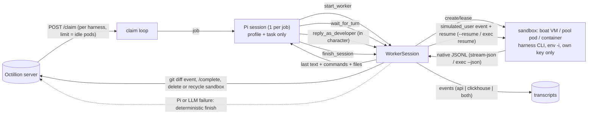

# Octillion orchestrator

The orchestrator claims queued simulation sessions from the Octillion server. Each session runs a coding-agent CLI
(the "sub-agent": Claude Code, Codex, ...) headless in a throwaway sandbox, and streams its native JSONL to the transcript store.
When the sub-agent stops to ask the developer something, an orchestrator agent built on **[Pi](https://pi.dev)**
answers in character as that developer, and the same sub-agent conversation resumes.

Two entry points share the same deterministic core:

| entry | what it does |
|---|---|
| `npx tsx orchestrator/main.ts` | **Orchestrator agent.** Pi (embedded through its SDK) plays the developer for up to `max_user_turns` replies. |
| `npx tsx orchestrator/worker.ts` | **Deterministic worker, no LLM.** It runs the harness once and finishes. The Pi path falls back to this. |

```
orchestrator/
  main.ts         runs a host pack's orchestrator (packs/<id>/main.ts) or the deterministic worker
  packs/octillion/ (the octillion host pack's, mold_v0-039) Pi extension package: index.ts (tools), prompt.ts (system prompts), main.ts (host), research*.ts, skills/
  core/           config, sessions, runners (boat; docker/local/pool for tests), host guard, fleet client, sink, boat client
  harnesses/      adapters.ts + credentials.ts: per-harness argv, resume, digest, credential mapping
  fleet/          plan.ts (standalone per-agent plan), status.ts (pods per group)
  deploy/         boat-orchestrators.ts (launcher, runs on the main VM or a laptop), in-sandbox.ts (helpers it runs inside)
  images/         Dockerfile.<harness> (tests) and boat-setup/<harness>.sh (pinned installs on boat VMs)
  test/           integration.ts, research.ts, boat-fleet.ts
  worker.ts       claim loop + deterministic run
  .pi-upstream/   Pi source clone, for reference only (gitignored)
```

## Production topology: everything agent-related runs on boat.dev

| where | what runs there |
|---|---|
| **Main VM** | Only the server stack: Postgres, ClickHouse, the Octillion server and Caddy. It may run the launcher (`npm run boat-orchestrators -- …`), which only calls APIs. **No orchestrator, Pi, harness or pod.** |
| **Orchestrator sandboxes** (boat, `small`, 30-day TTL, `octi-orch-*`) | One orchestrator each (Pi brain + claim loop + research loop) under systemd (`Restart=on-failure`; a clean idle exit is final). The env file (0600) holds only `OCTILLION_URL`, `OCTILLION_WORKER_TOKEN`, `ORCHESTRATOR_ID`, `RUNNER=boat`, `POD_CAPACITY`, `OCTILLION_HOST_ROLE` and boat's own `BOAT_ID`. The boat key and the GPT brain come from the broker at runtime. |
| **Worker sandboxes** (boat, `default`, ephemeral, `octi-w-<orchestrator>-<agent>`) | One fresh VM per agent session, created **from inside** the orchestrator sandbox and deleted when the session ends. Resume and simulated-developer turns stay in it. It holds only per-session gateway tokens, **never the worker token**. |

- **Host guard** (`core/host-guard.ts`). The orchestrator refuses to start unless all of the following hold:
  - `OCTILLION_HOST_ROLE=boat-orchestrator`;
  - the launcher's root-owned marker `/etc/octillion/host-role` is present;
  - boat's own indicators are present (`BOAT_ID`/`BOX_ID` and `/etc/ascii` + `/home/user/.ascii`, seen on live boat VMs);
  - `BOAT_ID` equals the marker's sandbox id;
  - `RUNNER=boat`.
  
  `pool`, `docker` and `local` need `OCTILLION_DEV_ALLOW_LOCAL=1`. That flag is for tests only and prints a loud banner. The check runs before any credential is fetched, in the claim loop, in research-only mode and in the Pi CLI extension.
- **Fleet semantics on boat.** The server's per-agent assignment (`pods`, for example 8/5/3/1/1/1/1 of 20) is the **maximum number of concurrent worker sandboxes per agent group**.
  - Each group claims with `{agent_ids:[id]}`, limited by its free slots.
  - SIGTERM kills the running sessions (deleting their worker sandboxes) and leaves the fleet (`DELETE /api/worker/fleet/:id`).
- **Harness pins** (registry `harness_version`). Boat preinstalls claude 2.1.296, codex 0.162.1, opencode 1.18.35 and pi 1.1.0, which are kept when they match the pin.
  - cline and kilo (and any mismatched pin) are installed at sandbox start with `images/boat-setup/<harness>.sh` (cline about 29s, kilo about 10s).
  - Each harness is verified with `--version` as an **unprivileged `env -i` user**, the way the agent runs it.
  - **Boat VM gotcha (fixed).** `/usr/local/bin/node` is a symlink into `/home/user/.nvm`, which other users can't read, so they fell back to `/usr/bin/node` v20. That broke pi and made cline warn. The runner and `_common.sh` replace it with a real copy.
  - **Next:** named boat snapshots per harness (`images/boat-snapshot.sh`) would make cline/kilo sandboxes start without the install step.
- **Start rate.** Every create goes through a client-side gate (`BOAT_STARTS_PER_MINUTE` 10, `BOAT_STARTS_PER_HOUR` 50 per orchestrator) and backs off on 429/503 (Retry-After, else 5s → 2min), keeping the same Idempotency-Key.

### Launcher (`npm run boat-orchestrators -- <cmd>`, from `orchestrator/`)

It needs only `OCTILLION_URL` (the **public** server URL) and `OCTILLION_WORKER_TOKEN`. The boat key comes from the broker.

| command | what it does |
|---|---|
| `budget [n]` | plan limits vs `n` orchestrators |
| `up <n> [--skip-preflight]` | Prints the budget and refuses if it's exceeded. Then it creates the missing orchestrator sandboxes (small, 30-day TTL, the maximum), uploads the code as a tarball through the files API (130 KB, chunked under 5 MiB, no node_modules), runs `npm ci`, writes the env file, marker and systemd unit, and runs the **preflight** (from inside the sandbox: `GET $OCTILLION_URL/healthz` over public HTTPS; it fails clearly otherwise). Then it starts the service |
| `status` | per orchestrator: sandbox, service state, uptime, TTL left, fleet check-in and assignment, live worker sandboxes |
| `logs <id> [n]` | orchestrator journal, secrets redacted |
| `renew` | resets every orchestrator's TTL to 30 days |
| `update` | redeploys the code and restarts gracefully |
| `down <id>\|--all` | `systemctl stop` (SIGTERM: leaves the fleet and deletes its workers), deletes leftover workers, deletes the sandbox |
| `selftest` | Live check (below). Everything it creates is deleted, and the final listing is verified |

**Budget** (live `GET /limits`, $20 plan):
- 100 concurrent sandboxes; 12/60/200 starts per minute/hour/day.
- Each orchestrator needs 1 + `POD_CAPACITY` (20) = 21, so **at most 4 orchestrators** (84 sandboxes). `up 5` is refused (105 > 100).
- **Throughput ceiling: ~196 agent sessions/day.** Every session is one fresh worker sandbox, which counts as one boat start, against 200 starts/day.
- The $100 plan gives 300 concurrent and 840 starts/day.

### On-demand orchestrators (server autoscaler, `src/autoscaler.ts`)

In production nobody runs `up`. The server starts orchestrators when there is work and they go away when idle. The launcher shares its code with the autoscaler through `deploy/boat-lib.ts`.

**One orchestrator per job (`OCTILLION_ORCH_PER_JOB=on`, the default).**

- Every onboarding research and every simulation with claimable queued sessions gets its own orchestrator, launched with `ORCHESTRATOR_JOB=<rsh_… | sim_…>` (row: `orchestrator_sandboxes.job_id`, `pods`).
- A research orchestrator runs that one research (one sandbox, no workers). A run orchestrator runs only that simulation's sessions on up to `OCTILLION_JOB_POD_CAPACITY` (40) worker sandboxes: `min(40, its unfinished sessions, what the boat plan has free)`.
- Isolation is server-side: claims carry `simulation_id` / `research_id`, and a bound orchestrator's fleet check-in returns pod groups built from its own run's queued and running sessions (per agent, never above demand). Bound orchestrators are left out of the shared fleet plan.
- Exit: the check-in returns `job.done` once the run completes or is cancelled, or the research completes or fails. The orchestrator then takes the graceful path (leave → `draining` → deleted next tick). Backstop: a bound orchestrator whose job ended over 3 minutes ago and runs nothing is deleted. The idle exit still applies.
- Launch order: research first (a customer is waiting), then runs, oldest first. Each launch reserves 1 + its pods on the boat plan; a run that does not fit waits for the next tick. At most `OCTILLION_MAX_JOB_ORCHESTRATORS` (12), 2 launches per tick. A run whose orchestrator idled out with sessions still queued is not relaunched for `OCTILLION_ORCH_IDLE_MINUTES` unless new sessions are queued (adaptive batches are).
- Recycle on deploy works per job: an old-code orchestrator gets no pods, a fresh one is launched for its job, and the old one is deleted once idle.
- Context between the two kinds goes only through the database, never directly: research writes the product profile, the personas (each with a developer environment, see below) and the problems, each also phrased in every persona's own words; `simulations.research_id` records which research a run came from.
- Tests: `npx tsx orchestrator/test/per-job.ts` (PGlite + mock boat).

`OCTILLION_ORCH_PER_JOB=off` restores the shared fleet described below.

### Developer environments (per persona, `core/environment.ts`, `core/env-install.ts`)

What a persona's developer has on their machine goes into the harness, not into a note for the simulated developer.
No GUI toolchains are installed.

- **Editor profile** (`vscode`, `zed`, `intellij`, `neovim`, `terminal`): picks the language servers that editor uses by default for the task's language. Zed: vtsls, basedpyright + ruff. VS Code, IntelliJ and Neovim: the closest open servers (typescript-language-server, pyright, jdtls, ...). Terminal: none.
- **CLI tools** from a pinned catalog (ripgrep, jq, gh, psql, uv, kubectl, terraform, cloud CLIs, ...). Every developer gets ripgrep and jq.
- **Skills and standing rules** the developer wrote for their coding agent, scaled by seniority (juniors 0-1 skills, seniors 3-6, at most 6). Written to each harness's user-level paths:
  - Claude Code: `~/.claude/skills`, `~/.claude/CLAUDE.md`
  - Codex: `~/.agents/skills`, `~/.codex/AGENTS.md`
  - OpenCode: `~/.config/opencode/skills`, its `AGENTS.md`
  - Kilo: `~/.kilo/skills`, rules via `instructions`
  - Pi: `~/.pi/agent/skills`, its `AGENTS.md`
  - Cline: `~/.cline/skills`, `~/.cline/rules`
  - Antigravity: `~/.gemini/antigravity-cli/skills`, `~/.gemini/GEMINI.md`
- **The task in the persona's words**: `scenarios.prompt_variants` (by persona slug). Juniors state the outcome; seniors add constraints and acceptance criteria.
- **Resolution at claim** (`src/worker.ts`): the editor's servers for the task's language, the base CLIs, and the persona's tools, skills and rules.
  - Anything that names the product or a competitor is withheld and listed in `dropped`.
  - Without a persona environment: VS Code defaults.
  - `OCTILLION_DEV_ENV=off` disables environments.
- **Install** (boat worker sandbox, before the first run): only what the session needs. A tool already on the sandbox is kept (`present`), so nothing is reinstalled. Pinned and system-wide; a tool that fails is reported and the session runs without it.
- **Wiring:**
  - Claude Code: official LSP plugins (`claude-plugins-official`), or a local `.lsp.json` plugin.
  - OpenCode and Kilo: the `lsp` user config.
  - Codex, Cline, Pi and Antigravity: Serena (LSP over MCP).
  - Config goes only under the agent's HOME; `.serena/` is excluded from the scored diff.
- **Zed personas run over ACP**, as Zed's agent panel does (`harnesses/acp-client.mjs`). It is enabled in production with `OCTILLION_ZED_ACP=on` (the code default is off). Live smoke runs on 2026-10-14 passed with real models over our gateway for Claude Code, Codex, OpenCode, Pi and Cline, each with a developer reply over `session/load`, for about $0.75 in total. Kilo's `kilo acp` never answered the prompt, so Kilo runs as a CLI.
  - The client advertises Zed's capabilities and `clientInfo`, sends the prompt as plain text, forwards no MCP servers, and allows permission requests.
  - It serves `fs/*` and `terminal/*` on the workspace, and reloads the session for developer replies.
  - Routes: `claude-agent-acp` (runs the pinned `claude`), `codex-acp` (runs the pinned `codex`, authenticated with the `api-key` method), `opencode acp`, `cline --acp` (`CLINE_PROVIDER`/`CLINE_MODEL`) and `pi-acp`. Kilo and Antigravity run as a CLI.
  - History that `session/load` replays is not re-emitted.
  - Events are `acp.*` (whole messages and tool calls), scored like any harness.
- **Recorded:** an `environment` transcript event and session `metadata.environment` (launch, editor, language, present / installed / failed / dropped, skills, wiring, seconds).
- **Tests:** `orchestrator/test/per-job.ts` (resolution, blindness, wiring, skills, variants) and `orchestrator/test/acp-client.ts` (the client against a mock ACP agent built with the official SDK).

- **Leader.** One server instance acts at a time, via a lease row in `autoscaler_lease` (renewed every tick, expires after 3 ticks). An advisory lock wouldn't work: session locks are per connection, and xact locks can't span a launch.
- **Demand, every `OCTILLION_AUTOSCALE_TICK_SECONDS` (15).** Counts queued and running `agent_sessions` (only agents the fleet schedules) plus queued and running `product_research`.
  - With no demand, desired = 0. Otherwise desired = `ceil(sessions / OCTILLION_POD_CAPACITY)`, and at least 1 if there is research.
  - Desired is clamped to `OCTILLION_MAX_ORCHESTRATORS` (4) and to the live boat budget (`(1 + capacity) × n ≤ plan concurrency`), with at most 2 launches per tick.
- **Launch.** Uses the vault boat key (`useCredential("boat")`). A `booting` row is written in `orchestrator_sandboxes` first, so a crash can't double-launch. The launch path is the same as `up`: code tarball, `npm ci`, env file, marker, unit and preflight. The worker token goes only into that sandbox's 0600 env file.
- **Scale down.** An orchestrator with no claimable work for `OCTILLION_ORCH_IDLE_MINUTES` (10) SIGTERMs itself. It leaves the fleet (the row becomes `draining`) and exits 0, so systemd doesn't restart it. The next tick deletes the sandbox.
- **Reaping, each tick, against boat's listing by the `octi-orch-` prefix:**
  - sandbox gone or draining → delete;
  - no fleet check-in for `OCTILLION_ORCH_STALE_MINUTES` (5) → delete;
  - stuck booting for more than `OCTILLION_ORCH_BOOT_MINUTES` (10) → delete;
  - TTL nearly expired → delete;
  - `octi-orch-*` sandboxes with no row (orphans) → delete;
  - leftover `octi-w-<orch>-*` workers of reaped orchestrators → delete.
- **Cold start (measured live 2026-10-10).**
  - Code upload + `npm ci`: service active in **~8s** (create 0.5s, ready 0.7s, code 3.7s).
  - From a named snapshot (`OCTILLION_ORCH_SNAPSHOT=on`): **~22s**, because restoring the image is slower than this small install, plus ~170s per build.
  - Snapshots are therefore opt-in. The first session additionally waits for its worker sandbox.
- **Visibility.**
  - `get_simulation` / `get_onboarding` return `capacity` (e.g. "starting orchestrator…") while work is queued.
  - `GET /api/admin/autoscaler` and `npm run fleet:status` show the knobs, demand, the last tick and the sandbox table.
- **Kill switch.** `OCTILLION_AUTOSCALE=off` stops all launches and deletes. Running orchestrators still idle out. The autoscaler also stays off unless `PUBLIC_URL` is https and `OCTILLION_WORKER_TOKEN` is set.
- **Tests.** `npx tsx orchestrator/test/autoscaler.ts` (PGlite + mock boat, 15 checks) covers:
  - launch on queue;
  - no double launch with two instances;
  - idle → drain → delete;
  - stale and stuck reaping (and their leftover workers);
  - orphans;
  - the cap;
  - the kill switch.

**Go-live needs a public HTTPS URL for the server** (domain + Caddy TLS). Orchestrator and worker sandboxes reach `/api/worker/*` and `/gw/*` over the internet. Until then, `up` stops at preflight.

## Architecture



Per job: claim → open a sandbox (boat VM, or a leased pool pod) → launch the harness with the scenario prompt,
verbatim on stdin → stream its JSONL → **simulated-developer loop**: Pi reads the sub-agent's last message. If the
sub-agent is waiting on the user (a question, a choice, a confirmation, or "should I proceed?"), Pi writes the developer's
reply. The reply is emitted as `{"type":"simulated_user","turn":n,"content":...}`, and the same harness conversation
resumes with it, in the same sandbox and workdir. This repeats up to `job.max_user_turns` (default 5) →
`{"type":"file_edit","name":"git diff","content":...}` → `/complete` → the sandbox is deleted (boat) or recycled (pool).

### Pi embedding: SDK in-process, one Pi session per job

Pi ([earendil-works/pi](https://github.com/earendil-works/pi), MIT) is used through its npm SDK,
`@earendil-works/pi-coding-agent@1.1.0`. The reference clone is pinned at
**`42a3497d03ad17e308a2299fa824727894f2c0ec`** (2026-10-09), and the package version matches it. It is declared in
`orchestrator/package.json` and installed in `orchestrator/node_modules`, not in the root package.json.

- **Why the SDK and not RPC or print mode.** The tools need direct access to live in-process state: sandboxes,
  streams, timers and the transcript sink. RPC would add a child process and a wire protocol and buy nothing.
  `createAgentSession()` gives full control: the tool allowlist, the system prompt, in-memory settings and sessions,
  and a model runtime isolated from `~/.pi`.
- **Why one Pi session per job, not one Pi managing N workers.** Each developer profile stays in its own context,
  so profiles can't bleed between jobs. Context stays small: about 2-6k tokens per turn, with no compaction. Failures
  are isolated per job, and the fallback is per job. Concurrency is plain `Promise` parallelism in one Node process,
  with no LLM attention split across workers.
- **What Pi can do.** It gets only the octillion pack's Pi tools: `start_worker`, `wait_for_turn`, `reply_as_developer`,
  `finish_session`. `claim_jobs` is added in manual CLI mode. Pi's built-in read/bash/edit/write tools are off, and so is
  the discovery of extensions, skills, context files and `~/.pi` settings. The model runtime uses its own temp `auth.json` and `models.json`.
- **Guards in the tools, not the prompt.** The tools enforce `max_user_turns`, "reply only when the run ended
  cleanly and is resumable" and "finish once". The status sent to `/complete` is computed from the harness result. Pi's
  `status` and `note` are recorded only as `orchestrator_status` / `orchestrator_note` metadata.
- **Deterministic fallback.** If the Pi setup fails, the LLM errors after retries, Pi exceeds the session budget, or Pi ends
  without finishing, the host finishes the session itself. If Pi never started the worker, the host runs the job
  deterministically. A job is never lost to an LLM failure. `/complete` metadata records `orchestrator` (`pi`,
  `pi+fallback` or `fallback`), `orchestrator_error`, `orchestrator_cost_usd`, `orchestrator_tokens_*` and
  `orchestrator_llm_calls`.

Manual and debug use from the Pi CLI: `pi -e ./orchestrator/packs/octillion --no-builtin-tools --no-context-files`. This is
manager mode, with `claim_jobs` and the `octillion-orchestrator` skill.

### The simulated developer: blindness

`packs/octillion/prompt.ts` exports `SIMULATED_DEVELOPER_SYSTEM_PROMPT` (the founder can tune it),
`ORCHESTRATOR_SYSTEM_PROMPT` (the tool protocol plus those rules) and `jobPrompt()`. Pi answers as `job.profile`: role,
experience, company size, stack, constraints, tone and instructions. With no profile, it answers as a neutral
"experienced developer who wants the task done; answers briefly". The prompt requires the following:
- It never introduces a product, vendor, library or service name that the sub-agent or the task did not already mention.
- It chooses between offered options only when the profile's constraints decide it. Otherwise it says "your call".
- It writes one to three short chat sentences, and never mentions simulation, AI or evaluation.
- It treats "done" or "progress" messages, and optional offers made after finishing, as **not waiting**.

Pi sees only the profile, the task prompt and the sub-agent's output. That output is the last text (up to 8k chars) plus up to
25 commands and 40 files. It never sees the customer, the product, or any org, product, session or simulation ids. Tool results carry only a
random `w_xxxxxxxx` handle. The orchestrator key (`ORCHESTRATOR_API_KEY`) is used only in the host process. It is never
passed to a sandbox. The tests checked transcripts and sandbox traffic for it.

### Harness adapters (`harnesses/adapters.ts`)

One `HarnessAdapter` per registry `harness` id. Each adapter defines the binary, the env for that harness's key, `launchArgv`, `resumeArgv`,
and a digest that extracts `{lastText, commands, files, sessionId, error}` from the JSONL.

| harness | launch (input on stdin) | resume (reply on stdin) | id from |
|---|---|---|---|
| `claude-code` | `claude -p --output-format stream-json --verbose --model M --dangerously-skip-permissions [--max-budget-usd N]` | `claude -p --resume <session_id> ...same flags` | `system/init.session_id` |
| `codex` | `codex exec --json --model M --dangerously-bypass-approvals-and-sandbox --skip-git-repo-check --color never -C <workdir> -` | `codex exec resume <thread_id> --json --model M --dangerously-bypass-approvals-and-sandbox --skip-git-repo-check -` | `thread.started.thread_id` |

The flags were checked against the installed CLIs (claude 2.1.296 `--help`, codex 0.162 `exec resume --help`).
- **Claude Code:** `--no-session-persistence` is dropped, because resume needs the stored session.
- **Codex:** `--ephemeral` is dropped, because it disables the rollout file that resume reads. `exec resume` has no `-C` or `--color`, so the runner starts it in the workdir.
- **Other harnesses** (added 2026-10-10). Flags were checked against each pinned CLI's `--help` in `orchestrator/images`.
  Every adapter except Cursor and Amp also ran end to end, launch and resume, through the same `docker exec -u agent env -i` path
  against a scripted mock LLM. The captured stdout is in `harnesses/fixtures/<harness>.jsonl`, and `scripts/smoke.ts` replays it
  through the digest and the server scorer. Cursor's and Amp's fixtures are built from the vendor docs and the CLI's own source,
  because their backends can't be mocked. `bash -c 'exec "$@" "$(cat)"'` below means the CLI only takes the prompt as an argument,
  so stdin becomes the last argv element.

| harness | launch (input on stdin) | resume | id from |
|---|---|---|---|
| `copilot` | `copilot --output-format json --allow-all-tools --no-auto-update --model M` | `... --resume <id>` | `result.sessionId` |
| `cursor` | `bash -c 'exec "$@" "$(cat)"' cursor-agent -p --output-format stream-json --force --trust --model M --` | `... --resume <id> --` | `session_id` |
| `opencode`, `kilo` | `opencode run --format json --auto -m provider/model` (`kilo run ...`) | `... -s <id>` | `sessionID` |
| `gemini-cli` | `gemini -o stream-json --approval-mode yolo --skip-trust [-m M]` | `... --resume <id>` | `init.session_id` |
| `qwen-code` | `qwen -o stream-json --yolo --auth-type openai -m M` (DashScope key as `OPENAI_API_KEY`) | `... --resume <id>` | `session_id` |
| `antigravity` | `bash -c '<write modelProvider=gemini settings once>; exec "$@" "$(cat)"' agy --output-format stream-json --dangerously-skip-permissions -p` | `... --conversation <id> -p` | `conversation_id` |
| `pi` | `pi -p --mode json --model provider/model` | `... --session <id>` | `session` header `id` |
| `amp` | `amp -x --stream-json [--mode M]` (settings `amp.dangerouslyAllowAll` written once) | `amp threads continue <id> -x --stream-json` | `session_id` (thread) |
| `droid` | `droid exec -o stream-json --skip-permissions-unsafe -m M` | `... -s <id>` | `session_id` |
| `cline` | `bash -c 'exec "$@" -k "$ANTHROPIC_API_KEY" -- "$(cat)"' cline --json --auto-approve true -P anthropic -m M` | **not supported** | none |

- **Cline cannot resume headlessly.** In 3.0.70, `cline --id <session> --json <prompt>` fails with "JSON output mode requires a
  prompt", and the JSON stream does not carry the session id. Its adapter has `canResume: false` and never reports a session id,
  so Cline sessions report `can_reply=false` and the orchestrator offers no simulated-developer replies. Cline also rejects a
  one-word prompt as an unknown command.
- **Keys.** The keys beyond `ANTHROPIC_API_KEY` and `OPENAI_API_KEY` are read from the worker env: `COPILOT_GITHUB_TOKEN`
  (or `GH_TOKEN`), `CURSOR_API_KEY`, `GEMINI_API_KEY`, `DASHSCOPE_API_KEY`, `AMP_API_KEY` and `FACTORY_API_KEY`. OpenCode,
  Kilo, Pi and Cline get the Anthropic key, because the registry models for them are `anthropic/...`.
- **Usage accounting** below still understands only the Claude and Codex formats. Token counts for the other harnesses stay
  in their raw events.
- **Boat:** only `claude`, `codex`, `pi`, `opencode` and `cursor-agent` are preinstalled on boat VMs. The others need the
  per-harness named snapshots (`orchestrator/images/boat-snapshot.sh`) wired into sandbox creation. Until then, run them with
  `RUNNER=pool` or `RUNNER=docker`.

Usage: Claude's `result` events are **summed across runs**, because each resume reports its own usage and cost. Codex sums
`turn.completed.usage` and reports no cost.

## Sandboxes (`RUNNER`)

| runner | sandbox | notes |
|---|---|---|
| `boat` (default) | one fresh [boat.dev](https://docs.boat.dev) VM per session | REST API, see below |
| `pool` | warm per-harness Docker pods, sized from the server's global fleet plan | see "Warm pod pool" |
| `docker` | one long-lived container per session from `SANDBOX_IMAGE` | `docker exec` per run |
| `local` | host CLI in a temp dir | dev only, no isolation |

Every runner exposes the same `Sandbox` interface: `runTurn(argv, stdin)`, `diff()`, `kill()` and `cleanup()`.
Resumes run in the same sandbox. Docker and pool runs use `docker exec -u agent ... env -i <image env without OCTILLION_*> <KEY>="$KEY"`.
Key values travel as `docker exec -e NAME`, so they never appear in argv or the container env.

### boat.dev runner

Base URL `https://boat.dev/api/v1`, `Authorization: Bearer $BOAT_API_KEY` ([API v1](https://docs.boat.dev/api/v1)).

1. `POST /sandboxes {type, ttlSeconds, noEnv: true, snapshots: false}` with an `Idempotency-Key`. `noEnv` keeps account
   secrets off the VM ([create](https://docs.boat.dev/api/reference/sandboxes/create-sandbox)). Then poll `GET /sandboxes/{id}` until the state is `ready`, `idle` or `running`.
2. `PUT /files`: the env file and scripts go into `/tmp/octi` (mode 700). `prepare.sh` (a sync exec) creates an unprivileged `agent` user,
   builds a PATH to the preinstalled CLIs, installs the harness env file at `/home/agent/.octi-env` (mode 600), and
   optionally clones the repo into `/home/agent/work`.
3. Each run writes `in-N.txt` and `launch-N.sh`, then `POST /commands {detached: true}` (sync exec caps at 600s). The run is
   `env -i` as `agent`, and its stdout goes to `out-N.jsonl`. The worker follows it with `POST /commands {stream: true}` running
   `timeout 540 tail -n +<line> -F --pid=<pid>`, as NDJSON frames `{"type":"stdout","data":...}`. It reconnects by line number,
   and `GET /commands/{processId}` reports when the run has exited ([exec](https://docs.boat.dev/api/reference/agent/execute-sandbox-command)).
4. Finish: `DELETE /sandboxes/{id}` with `X-Ascii-Confirm-Delete` force-stops the VM and deletes it. If that fails, the worker falls back to `POST /stop {force:true}`.
   The TTL is `MAX_SESSION_MINUTES + BOAT_TTL_MARGIN_MINUTES`, and exec'd work does not extend it.

**Why not Boat's managed `boat prompt` / `POST /prompt` + `GET /events`.**
Boat injects its own system prompt, a `boat` skill and a `computer` MCP server into managed harnesses
([integrated agents](https://docs.boat.dev/integrated-agents)), which breaks blindness. Its events are also a
normalized format, `{type: "prompt"|"response", data: {content, is_streaming, tools: [{use, result}]}}`, with no
Claude `result` usage or cost. We run the stock preinstalled CLI as an isolated user and keep the native stream.

**Costs and limits** ([pricing](https://docs.boat.dev/pricing), 2026-10):

| size | $/hour |
|---|---|
| `small` | 0.018 |
| `default` | 0.036 |
| `large` | 0.072 |
| `xlarge` | 0.20 |

- Billing is per second, and only while running. A 45-minute `default` session costs about $0.03 of VM time.
- The $20/mo plan gives 100 concurrent VMs and 12/60/200 starts per minute/hour/day.
- The trial allows 2 concurrent VMs, and its TTL is at most 2h.
- VMs run in the EU.

Use a `ci`-preset key: `boat api-key create octillion-worker --preset ci --ttl 90d`.

**Live findings (2026-10-10, one smoke).** The orchestrator's boat key (`/root/octillion-live/secrets/boat.env`) authenticates.
- `GET /me` returns `{ok, type:"user.info", user:{id, login, email, ...}}`.
- `GET /limits` returns `{currentLimits:{activeSandboxes, creationRatePerMinute/PerHour/PerDay}, sandboxPlanKey, creditBalanceHours, startLimits, starts:{minute,hour,day}, ...}`.
  The account is on the **$20 plan (`box_20`)**. It has paid history, so it is not on the trial with its 2h TTL cap. Limits: **100 active sandboxes**, **12/60/200 starts per minute/hour/day**, 555.6 credit hours.
  The maximum TTL is 30 days ([long-running tasks](https://docs.boat.dev/long-running-tasks)).
- **`POST /sandboxes` returned `403 api_key_action_forbidden`: "This API key cannot perform sandbox.create."**
  The stored key is scoped without `sandbox.create`, so no sandbox was created, and the exec/version checks could not run.
  The runner now turns this error into a clear message. **Store a `ci`-preset key in the vault.**
  The remaining runner behaviour (create shape, exec, stream, detached, delete) is verified only against the documented API through the mock.

## Credentials (key vault, broker, gateway)

The contract is in `docs/credentials.md`. The orchestrator host holds **only `OCTILLION_URL` and `OCTILLION_WORKER_TOKEN`** (`CREDENTIALS_MODE=broker`, the default).

```
startup / 401 / near expiry ── POST /api/worker/orchestrator/credentials {orchestrator_id} ─▶ boat key + Pi's LLM {provider, base_url (gateway), ogw_ token}
per session (after claim, before every harness run when the token is close to expiry)
                           ── POST /api/worker/sessions/:id/credentials ─▶ providers {anthropic|openai|google|dashscope: gateway, copilot|cursor|amp|factory: direct}
harness adapter (harnesses/credentials.ts) maps providers ─▶ env (secrets) + a setup snippet (config files, no secret values) + an optional argv rewrite
runner injects env only at exec time: docker/pool `docker exec -e NAME … env -i …`; boat a per-run 0600 file that is sourced and deleted before exec
```

- **Orchestrator side.**
  - Pi's anthropic provider gets `baseUrl` from the gateway and its key from the broker's `ogw_` token. The token is refreshed before each job when it is close to expiry, and after a 401.
  - The boat key is set from the broker. A boat 401 triggers one refetch and a retry, which covers rotated keys.
  - No provider key exists on the host.
- **Sandbox side.**
  - Session tokens are `ogw_` gateway tokens, scoped to that session and short-lived.
  - Real keys reach a sandbox only for the direct-mode, vendor-hosted harnesses.
  - The adapter's neutral env has every `*KEY`/`*TOKEN`/`*SECRET`/`*_BASE_URL` var stripped before the credentials are applied, so a stray host env var can never leak in.
- **`CREDENTIALS_MODE=env` (dev only).** Providers are built from this process's env: `ANTHROPIC_API_KEY`, `OPENAI_API_KEY`, `GEMINI_API_KEY`, `DASHSCOPE_API_KEY`, `COPILOT_GITHUB_TOKEN`, `CURSOR_API_KEY`, `AMP_API_KEY`, `FACTORY_API_KEY`, and optional `*_BASE_URL`s. Pi uses `ORCHESTRATOR_*` and the boat runner uses `BOAT_API_KEY`.

### Per-harness credential mapping (verified 2026-10-10 against the pinned images)

| harness | provider | mode | how the base URL is overridden (env / config) | verified |
|---|---|---|---|---|
| claude-code 2.1.296 | anthropic | gateway | `ANTHROPIC_BASE_URL=<gw>/anthropic` + `ANTHROPIC_API_KEY=ogw_…` (sent as `x-api-key`) | ✅ gateway |
| codex 0.162.1 | openai | gateway | `$CODEX_HOME/config.toml` `openai_base_url = "<gw>/openai/v1"` + `CODEX_API_KEY` (sent as Bearer). **The `OPENAI_BASE_URL` env is ignored**: codex called api.openai.com with the token. The built-in `openai` provider hard-codes `supports_websockets = true` and can't be overridden, so the setup also selects `model_provider = "octillion_gateway"`, a copy of it (`name = "OpenAI"`, `requires_openai_auth = true`) with `supports_websockets = false`: plain HTTP, no `426` WebSocket attempt | ✅ gateway (functional run on gpt-5; gpt-6.1-sol routes but declares tools in an `additional_tools` input item, which the fixture mock can't parse) |
| opencode 1.18.35 | anthropic | gateway | `OPENCODE_CONFIG_CONTENT={"provider":{"anthropic":{"options":{"baseURL":"<gw>/anthropic/v1"}}}}` + `ANTHROPIC_API_KEY` | ✅ gateway |
| kilo 7.8.8 | anthropic | gateway | `KILO_CONFIG_CONTENT` (same shape) + `ANTHROPIC_API_KEY` | ✅ gateway |
| pi 1.1.0 | anthropic | gateway | `~/.pi/agent/models.json` `{"providers":{"anthropic":{"baseUrl":"<gw>/anthropic"}}}` + `ANTHROPIC_API_KEY` | ✅ gateway |
| cline 3.0.70 | anthropic | gateway | The anthropic provider ignores every base URL (`-b` is refused for it; `ANTHROPIC_BASE_URL` and providers.json `baseUrl` are ignored). So: `cline auth -p openai -b <gw>/anthropic/v1` + `-P openai`, which goes to **Anthropic's OpenAI-compatible `/v1/chat/completions`** through the gateway | ✅ gateway (the server gateway must allow that path) |
| gemini-cli 0.63.0 | google | gateway | `GOOGLE_GEMINI_BASE_URL=<gw>/google` + `GEMINI_API_KEY` (`x-goog-api-key`), plus `~/.gemini/settings.json` `security.auth.selectedType=gemini-api-key` | ✅ gateway |
| antigravity 1.3.4 | google | gateway | `GOOGLE_GEMINI_BASE_URL` + `GEMINI_API_KEY` (`modelProvider: gemini`, set by the adapter) | ✅ gateway |
| qwen-code 0.25.0 | dashscope | gateway | `OPENAI_BASE_URL=<gw>/dashscope/compatible-mode/v1` + `OPENAI_API_KEY` (`--auth-type openai`) | ✅ gateway |
| copilot 1.0.95 | github_copilot | direct | `COPILOT_GITHUB_TOKEN`. GitHub-hosted models; BYOK `COPILOT_PROVIDER_BASE_URL` would change the product | direct by design |
| cursor 2026.10.01 | cursor | direct | `CURSOR_API_KEY`. Cursor-hosted backend, no base URL override | direct by design |
| amp 0.0.1791619249 | amp | direct | `AMP_API_KEY`. Amp-hosted backend | direct by design |
| droid 0.238.0 | factory | direct | `FACTORY_API_KEY`. Factory-hosted models; BYOK `customModels` would change the model | direct by design |

**How it was verified.** Each gateway-mode harness ran in its pinned image through the production code path: `harnessCredentials()` + `withCredentialSetup()` + `dockerExecHarness()` (`env -i`, `-e NAME`). Its requests went to a stand-in gateway that requires the `ogw_` token in `x-api-key`, `Authorization: Bearer`, `x-goog-api-key` or `?key=`, then forwards to the fixture mock LLM.
- Every LLM request carried the token. The run completed ("Installed left-pad with npm. Done.").
- The orchestrator process had real-looking canary keys in its own env. **No canary appeared** in the pod's container env, in files under `/home`, `/tmp` or `/root`, or in any gateway request.

### Pod groups per model (`RUNNER=pool`)

Pods are grouped per **registry agent** (harness + model), for example `claude-code/opus` and `claude-code/sonnet`. Each group is sized by its own usage share. Groups of one harness share its image.
- **Fleet assignment.** `POST /api/worker/fleet` returns `[{agent_id, harness, model, pods, image, version}]`. Standalone mode uses `fleet/plan.ts` `planFleet(size)` with the same per-agent rule: largest remainder, plus one pod per agent when the fleet has room.
- **Claim.** Each group claims with `{agent_ids:[agent_id]}`, with limit equal to its idle pods, so an Opus pod only gets Opus sessions.
- **Model check.** The pod asserts `job.model` equals the group's model (`ModelMismatchError`).
- **Labels.** `octillion.agent`, `octillion.harness`, `octillion.model`, `octillion.pool.owner`. `fleet/status.ts` reports per group.

## Warm pod pool (`RUNNER=pool`)

Each orchestrator runs up to `POD_CAPACITY` (≤ 20) warm Docker pods. N orchestrators run N×20 pods, and the
**usage proportions hold globally because the server plans the fleet** (`src/fleet.ts`):

- **Check-in.** At start and every `next_checkin_seconds`, the orchestrator calls `POST /api/worker/fleet {orchestrator_id: ORCHESTRATOR_ID, capacity}`. This
  registers it and acts as its heartbeat. The response's `assignment` is this orchestrator's share of the global per-agent plan.
  Orchestrators silent for longer than 90s drop out, and the server re-deals their pods.
- **Reconcile.** Missing pods are started warm. Surplus **idle** pods are removed. Surplus busy pods retire when their session ends.
- **Claim.** Each pod group claims with its own `agent_ids`, limited by its idle pods (see above). Claims skip groups without an adapter.
- **Run.** Every run goes through `docker exec -u agent` + `env -i`, with only this session's brokered credentials. Resumes run in the same pod.
- **Recycle.** After the session, the pod is destroyed and a fresh one is started while the group is below target.
- **Server unreachable.** The pool keeps its current pods and retries every 10s. With `FLEET_MODE=standalone`, it uses `planFleet(POD_CAPACITY)`.
- **SIGTERM.** `DELETE /api/worker/fleet/:id`, then drain and remove every pod this orchestrator owns.
- **Status.** `npx tsx orchestrator/fleet/status.ts [--owner ID] [--json]` shows idle and busy pods per group, against the server's global plan
  (with `OCTILLION_URL` and the token set) or the standalone plan.
- **Boat parity (next).** The same semantics on boat would mean N warm VMs per group, forked from per-harness named snapshots (the registry's `image.boat_snapshot`).

## Run until done (starter workspaces, done check, 100-turn cap)

**Why** (live, 2026-10-10, ses_LgbgZJQTay6N): a scenario without `repo_url` ran in an empty `/home/agent/work`.
- Codex said "The workspace at `/home/agent/work` is empty, so I can't inspect or modify the service yet."
- Pi answered with a path from its own host ("The project location I have is `/tmp/octillion-pi-…/cwd`").
- The session ended after 22-41s with an empty diff and verdict `none`.

**Starter workspaces** (`workspaces/<template>/`, `core/workspaces.ts`):
- The templates are `express-ts`, `nextjs-ts`, `node-ts`, `fastapi`, `django` and `go-http`.
- Each is a small, neutral project: framework only, no dev-tool SDKs.
- When a scenario has no `repo_url`, the runner writes the template into the workdir and commits it as "Initial commit". The diff, and so the done check, is taken against that commit.
- Selection is deterministic, in this order:
  1. the scenario's `template` (research or `save_scenarios`);
  2. then `language`;
  3. then keywords in the tags, title and prompt;
  4. then `node-ts` as the fallback.

**Done check** (`core/progress.ts`, deterministic; runs after every run):
- Done = the workspace diff is non-empty and changes code, a dependency manifest or config.
- Empty, docs-only, tests-only or lockfile-only diffs are not done.

**Loop:**
- While the agent is resumable and not done, the developer must reply. `wait_for_turn` reports `must_continue`, and `finish_session` is refused.
- Pi nudges in character. Without Pi, or as its safety net, `driveToDone` sends neutral canned nudges ("Please go ahead and implement it in this project.").
- Ends:
  - when done;
  - at `MAX_AGENT_TURNS` (100), counted in harness terms (`core/turns.ts`), summed across resumes and enforced natively where possible (Claude `--max-turns`), otherwise by SIGTERM to the CLI;
  - at `MAX_SESSION_MINUTES`;
  - after `GIVE_UP_RUNS` (3) nudged runs that change nothing.
- Lockfile content stays out of the scored diff (one "# lockfile changed" line instead), so transitive package names are never scored as mentions.
- `completed_reason` (done | turn_cap | time_cap | agent_gave_up | error) goes to `/complete`, the `agent_sessions.completed_reason` column, `get_agent_session` and `get_simulation`.

Test: `npx tsx orchestrator/test/run-until-done.ts` (fake Codex CLI on the local runner, mock worker API, 13 checks).

## Transcript sink (`TRANSCRIPT_SINK`)

| mode | behaviour |
|---|---|
| `api` (default) | Harness lines are sent verbatim to `POST /api/worker/sessions/:id/events` (NDJSON, every `FLUSH_INTERVAL_MS`). The server assigns seq and ts. |
| `clickhouse` | Events are inserted directly through the ClickHouse HTTP interface: `INSERT INTO {db}.transcript_events (org_id, product_id, simulation_id, session_id, model, seq, ts, type, text, raw) FORMAT JSONEachRow` with `date_time_input_format=best_effort` and basic auth. `seq` is a per-session counter that continues after `max(seq)` already stored. `ts` is ISO. `text` comes from `eventText()`, mirrored from `src/transcripts.ts`. `raw` is the event with seq, ts and type. |
| `both` | Both stores, with the **same seq and ts** written into the API copy. |

Heartbeats and `/complete` always go to the API. The server recounts events from the store when it scores.

## Cost note

- Orchestrator LLM calls per session: at most `max_user_turns + 1` decisions. Each decision is 1-2 small requests of about 2-6k tokens.
  A session with no question costs about 4 requests; a session with 5 replies costs about 13. The cost is recorded as `orchestrator_cost_usd`.
- Boat: $0.018/h (`small`) and $0.036/h (`default`). Pool pods cost whatever the Docker host costs.
- All harness and Pi LLM traffic is metered per session by the gateway.

## Env vars

| var | default | notes |
|---|---|---|
| `OCTILLION_URL`, `OCTILLION_WORKER_TOKEN` | `http://localhost:3000`, - | **The only secrets on the host.** The token never enters a sandbox or pod |
| `CREDENTIALS_MODE` | `broker` | `broker` (vault + gateway through the server) or `env` (dev: provider keys from this env, see Credentials) |
| `RUNNER` | `boat` | **Production: `boat` only.** `pool`, `docker` and `local` need `OCTILLION_DEV_ALLOW_LOCAL=1` (tests only; loud banner) |
| `OCTILLION_HOST_ROLE` | - | `boat-orchestrator`. Written by the launcher; the host guard requires it together with the root-owned marker and boat's indicators |
| `OCTILLION_DEV_ALLOW_LOCAL` | - | `1` bypasses the host guard. **Tests and local development only** |
| `ORCHESTRATOR_MODE` | - | `research`: a research-only worker that never claims coding-agent sessions |
| `FLEET_MODE` | `server` | `server` or `standalone`. For `RUNNER=boat`, `off` means plain `WORKER_CONCURRENCY` with no per-group caps |
| `BOAT_STARTS_PER_MINUTE` / `BOAT_STARTS_PER_HOUR` | `10` / `50` | client-side start gate per orchestrator (plan: 12/60/200 per minute/hour/day). 429s back off |
| launcher tuning | | The launcher forwards only these non-secret knobs from its own env into orchestrator env files: `MAX_SESSION_MINUTES`, `MAX_BUDGET_USD`, `MAX_USER_TURNS`, `MAX_AGENT_TURNS`, `GIVE_UP_RUNS`, `ORCHESTRATOR_THINKING`, `BOAT_SANDBOX_SIZE`, `RESEARCH_MAX_COST_USD`, `OCTILLION_ORCH_IDLE_MINUTES` (the autoscaler forwards the server's values) |
| `WORKER_CONCURRENCY` | `2` | parallel sessions for boat, docker and local. For the pool, capacity is the pod count |
| `MAX_SESSION_MINUTES` (45), `MAX_USER_TURNS` (5) | | hard kill, then `timeout`; default reply cap |
| `MAX_AGENT_TURNS` (100), `GIVE_UP_RUNS` (3) | | agent-turn cap per session (summed over resumes; Claude gets `--max-turns`); nudged runs without any workspace change before `agent_gave_up` |
| `WORKER_ID`, `WORKER_MODELS`, `WORKER_HARNESS`, `MAX_BUDGET_USD` | | claim filters; `MAX_BUDGET_USD` applies per Claude run |
| `POLL_INTERVAL_SECONDS` (5), `FLUSH_INTERVAL_MS` (2000), `HEARTBEAT_SECONDS` (60) | | |
| `ORCHESTRATOR_ID` | hostname | stable identity for orchestrator credentials, fleet check-in and the pod owner label |
| **orchestrator (Pi)** | | |
| `ORCHESTRATOR_MODEL` | `gpt-6.1-sol` | Fallback only. With `CREDENTIALS_MODE=broker` (default) the server decides the brain: its `ORCHESTRATOR_PROVIDER`/`ORCHESTRATOR_MODEL` (default `openai`/`gpt-6.1-sol`) come back from the broker with the gateway base URL and token |
| `ORCHESTRATOR_THINKING` (`low`), `ORCHESTRATOR_MAX_RETRIES` (3) | | |
| `ORCHESTRATOR_PROVIDER`, `ORCHESTRATOR_API_KEY`, `ORCHESTRATOR_API_URL` | | `CREDENTIALS_MODE=env` only |
| **transcripts** | | |
| `TRANSCRIPT_SINK` (`api`), `CLICKHOUSE_URL`, `CLICKHOUSE_USER`, `CLICKHOUSE_PASSWORD`, `CLICKHOUSE_DATABASE` (`octillion`) | | |
| **pool** | | |
| `FLEET_MODE` (`server`), `POD_CAPACITY` (20, ≤ 20; `FLEET_SIZE` is a legacy alias), `OCTILLION_REGISTRY`, `POOL_IMAGE_OVERRIDE` (dev/test) | | |
| **boat** | | |
| `BOAT_API_URL`, `BOAT_SANDBOX_SIZE` (`default`), `BOAT_TTL_MARGIN_MINUTES` (15), `BOAT_READY_TIMEOUT_SECONDS` (300), `BOAT_ORG`, `BOAT_AGENT_USER` (`agent`), `BOAT_ON_FINISH` (`delete`), `BOAT_DIFF_MAX_BYTES` | | the key comes from the broker (`BOAT_API_KEY` in env mode only) |
| **docker / local** | | |
| `SANDBOX_IMAGE` (`octillion-sandbox:latest`), `DOCKER_NETWORK`, `DOCKER_CPUS` (2), `DOCKER_MEMORY` (4g) | | docker and pool limits |
| `CLAUDE_BIN`, `CODEX_BIN` | | local runner only |

## Run

```bash
cd orchestrator && npm install && cd ..       # Pi SDK (orchestrator/package.json)
export OCTILLION_URL=https://octillion.example.com OCTILLION_WORKER_TOKEN=...   # nothing else secret

npx tsx orchestrator/main.ts                                         # boat.dev (key from the broker)
RUNNER=pool ORCHESTRATOR_ID=orch-eu-1 npx tsx orchestrator/main.ts   # warm pod pool, server-planned
npx tsx orchestrator/fleet/status.ts --owner orch-eu-1
npx tsx orchestrator/worker.ts                                                    # no LLM: one run per job

# dev without a vault
CREDENTIALS_MODE=env ANTHROPIC_API_KEY=... BOAT_API_KEY=... npx tsx orchestrator/main.ts
```

SIGINT/SIGTERM kills running sandboxes, which are reported as `failed`. In pool mode it also leaves the fleet and removes the pods. A repeated
signal within 3s is ignored, because npx and tsx both forward it. A 404 or 409 from `/events` or `/heartbeat` kills the sandbox and skips `/complete`.

## Security notes

- **Blindness.** A sandbox receives the prompt and replies on stdin, the optional repo, and this session's harness credentials
  (gateway `ogw_` tokens; real keys only for direct-mode vendor-hosted harnesses), plus neutral env.
  - It never receives Octillion ids, the worker token, the orchestrator's token, customer names, or `OCTILLION_*` image env.
  - Boat runs as a separate `agent` user under `env -i`, with none of Boat's tokens, skills or MCP.
  - Docker and pool runs use `env -i` with the image's neutral env.
- **Credential lifetime in a sandbox.** Docker and pool: env at exec time only, nothing on disk.
  Boat: a per-run 0600 file, deleted before the harness execs.
  Some harnesses persist their key themselves: cline saves `-k` into `~/.cline/data/settings/providers.json`, inside the session's own pod.
  That is acceptable because it is a short-lived gateway token and the pod or VM is destroyed afterwards.
- **Network.** Agents need egress. They run with skip-permissions flags, which are safe only because the VM, pod or container is the sandbox.
  Containers run non-root, with `--cap-drop ALL`, `no-new-privileges` and limits. Block 169.254.169.254 and private ranges with `DOCKER_NETWORK`.
- **Gateway tokens are not real keys.** Codex sent the `ogw_` token to api.openai.com when only `OPENAI_BASE_URL` was set, which is why the mapping
  uses `openai_base_url`. A misconfigured harness leaks at most a gateway token, never a vault key.

## Product onboarding research (`packs/octillion/research.ts`, docs/onboarding.md)

The orchestrator also claims research jobs: `POST /api/worker/research/claim`, polled next to the agent-session claims.
`ORCHESTRATOR_MODE=research` runs a research-only worker that never claims coding-agent sessions.
Each job gets a dedicated Pi session on the same broker brain (`openai/gpt-6.1-sol` via the gateway). It has research-only tools and no shell or file access:

| tool | what it does |
|---|---|
| `fetch_url(url)` | `core/safe-fetch.ts`: GET → readable text (scripts and styles stripped, ≤ `RESEARCH_FETCH_MAX_CHARS`, default 40k) plus fetchable same-site links. **Allowlist:** the job's website and docs hosts and their subdomains, registry.npmjs.org, pypi.org, crates.io, pkg.go.dev, and github.com / raw.githubusercontent.com for owners linked from the product's own pages. **SSRF:** DNS is resolved inside the socket's `lookup`. Private, loopback, link-local/metadata, CGNAT, multicast and reserved addresses are refused, and the checked address is the one connected to. Redirects are re-checked each hop (max 5). ≤ 25 fetches per job |
| `search_library(query, category?, language?)` | `GET /api/worker/library/tasks` |
| `report_progress(stage, note)` | `POST /research/:id/progress`. Also sent as a heartbeat every 60s |
| `validate(result_json)` | `POST /research/:id/validate` → `{ok, issues}` |
| `submit(result_json)` | `POST /research/:id/complete`. A 422 returns its issues to the model to fix. After 4 attempts (`RESEARCH_MAX_SUBMITS`) the job completes `failed` with the issues |

- **Prompt.** `packs/octillion/research-prompt.ts` (`RESEARCH_SYSTEM_PROMPT`, exported for tuning) tells the model to:
  - read the docs for real install commands, packages, import paths and domains;
  - pick 2-5 real competitors;
  - write 2-4 blind personas;
  - prefer library tasks, then write neutral, specific developer-voice problems: a stack, existing-app context and a concrete goal;
  - include 1-2 `avoid` problems;
  - never name the product, competitors, packages or domains in prompts;
  - give a rationale for each problem.
- **No LLM, no research.** If the broker gives no LLM, or the LLM errors (`LLM unavailable: …`), the job is completed `failed` with that error. Research is never invented.
- **Guards.** `RESEARCH_MAX_COST_USD` (default 2) aborts a job above that spend. Also `RESEARCH_MAX_MINUTES` (20), `RESEARCH_MAX_FETCHES` (25) and `RESEARCH_CONCURRENCY` (1).
- **Hermetic test.** `npx tsx orchestrator/test/research.ts` (about 30s). It uses the real server on PGlite, the real orchestrator, a fake product site (`RESEARCH_TEST_DNS` / `RESEARCH_TRUST_PRIVATE_HOSTS`, tests only), and a fake OpenAI Responses endpoint as the vault upstream, scripted to call every tool. It asserts the allowlist, blocking of private, metadata, off-allowlist and redirect targets, validate → 422 → revise → accepted, the saved profile, personas and scenarios, the LLM-unavailable failure, and that the brain went through the gateway.

## Boat topology tests

- **Hermetic** (`npx tsx orchestrator/test/boat-fleet.ts`, about 30s, 18 assertions). The real worker (`RUNNER=boat`) runs against a mock boat API and a mock Octillion server. It checks:
  - **Guard:** non-boat host, `RUNNER=local` without the flag, the dev flag banner, a marker/`BOAT_ID` mismatch, and that the real entry point refuses on this machine.
  - **Fleet caps:** per-group concurrent worker sandboxes are capped by the fleet assignment (opus 2, sonnet 1), and the caps are actually reached.
  - **Claims and lifecycle:** claims carry `{agent_ids:[group]}` with limit ≤ free slots; one fresh worker sandbox per session, all deleted.
  - **Start rate:** 429s are backed off and retried with no failed session.
  - **Budget math:** the launcher's budget calculations.
  - **Secrets:** the worker token and the boat key never appear in any worker sandbox file or command, and env files hold only harness credentials.
- **Live** (`npm run boat-orchestrators -- selftest`, 2026-10-10). This ran with the server not public. The orchestrator's env file held a placeholder token for the selftest.
  - **Guard:** orchestrator sandbox `bx_cq4wz87k` passed the guard under production rules, with `BOAT_ID` matching the marker. `RUNNER=local` was refused.
  - **Preflight** failed clearly: `cannot reach https://localhost:8443/healthz from this boat sandbox (ECONNREFUSED)`.
  - **Nested worker:** `bx_pemydpw9` was created **from inside** `bx_cq4wz87k`. It ran `echo ok` and Claude Code 2.1.296, had 0 `OCTILLION_*` env vars, and was deleted.
  - **Teardown:** both were deleted, and the final `GET /sandboxes` showed no sandbox of ours (0 active).
  - **Harness check** (`bx_4byem2zr`, deleted): all six harnesses behind the 7 scheduled agents passed `--version` as an unprivileged user at their pins.

- **Live end-to-end on the public server** (`https://octillion.useimmaculate.com`, 2026-10-10, about 1 minute per run).
  - **Setup:** `up 1` (POD_CAPACITY=3, MAX_SESSION_MINUTES=12, MAX_BUDGET_USD=1.5) gave orchestrator sandbox `bx_jnmcb8mm`; preflight OK; systemd active.
  - **Fleet:** the orchestrator checked in with assignment `{opus 1, codex 1, sonnet 1}`.
  - **Simulation:** a throwaway org ran an explicit simulation (`claude-code/sonnet` + `codex/default`, repeats 1). The worker sandboxes `bx_5xtnq2zj` and `bx_zry64uc9` were created **from inside** the orchestrator sandbox and deleted after their sessions.
  - **Sessions:** both completed with verdict `none` (both agents used `padStart` rather than left-pad). Claude used 69,296 input / 571 output tokens ($0.18). Codex used 40,271 input / 365 output. Pi (GPT, via the gateway) used about 11k input tokens per orchestrator (about $0.005 per session).
  - **Transcripts** are in ClickHouse (10 and 13 events). `gateway_usage` is metered per session.
  - **Token check:** a zero-knowledge scan in each worker sandbox (only `sha256(worker token)` was sent; 0.67M and 0.87M strings checked) found no worker token and no `OCTILLION_*` env.
  - **Teardown:** `down --all`, a final listing with none of ours, and the throwaway org deleted.
  - **A first run found a real problem:** Claude Code failed with `400 context_management: Extra inputs are not permitted`. The gateway's Claude upstream is Vertex, which rejects Claude Code's beta body fields. The claude-code mapping now sets `CLAUDE_CODE_DISABLE_EXPERIMENTAL_BETAS=1` in gateway mode; this was verified to drop the field.

## Integration test (real server, `orchestrator/test/integration.ts`)

```bash
orchestrator/images/build.sh claude-code          # once: the pinned Claude Code image
npx tsx orchestrator/test/integration.ts          # about 2 minutes, no API spend; ITEST_KEEP=1 keeps the logs
```

This runs the **real committed server** (`src/http.ts`) on a fresh PGlite, with `PUBLIC_URL` on the Docker bridge so pods can reach
`/gw`. It also runs the **real orchestrator** (Pi, `RUNNER=pool`, server fleet mode, `POD_CAPACITY=3`) on the real Claude Code image.
The orchestrator's environment holds only `OCTILLION_URL` and `OCTILLION_WORKER_TOKEN` as secrets.
Only the LLM vendor is fake. The vault's `anthropic` provider points at a local Anthropic-compatible server, set up with `npm run keyvault -- provider anthropic --upstream …`.
That server holds a random `sk-ant-canary-…` key, stored with `keyvault set`. It scripts the harness (one `Bash npm install left-pad`, then a final
text, with SSE usage) and Pi (start → wait → finish).
The org comes from `scripts/create-org.ts`. The product `left-pad` (package `left-pad`), 2 scenarios and `run_simulation`
(explicit `claude-code/opus` + `claude-code/sonnet`, 4 sessions) go through the real MCP endpoint.

| assertion | how |
|---|---|
| sessions complete, verdict `adopted` | `get_agent_session` for all 4 sessions |
| `gateway_usage` per session and for Pi | `GET /api/admin/gateway/usage`: requests, input and output tokens > 0 |
| session tokens revoked on completion | A token minted while the session ran returns 200 on `/gw/anthropic/v1/models`. After `/complete` it returns 401 `Gateway token is invalid, expired or revoked` |
| no canary leak | `/proc/*/environ` of the pods' processes (`ANTHROPIC_API_KEY=ogw_…` is seen there), container env and every transcript are free of the canary. The fake vendor only ever saw the canary in `x-api-key`, never an `ogw_` token |
| pod groups | The fleet plan and assignment are `{opus: 2, sonnet: 1}`. Pod labels match. Every session's `metadata.pool_agent` and `pool_model` equal its own `agent_id` and `model` |
| shutdown | SIGTERM → `DELETE /api/worker/fleet/:id`, 0 pods, 0 orchestrators registered |

The rig spawns `node_modules/.bin/tsx` directly, not `npx tsx`: `npx` exits on SIGTERM without forwarding it, which orphans the server and orchestrator processes.

## Verification

Local mocks, no live spend:
- **Pi loop.** Ask → reply → `claude -p --resume <id>` → finish, with the `simulated_user` event, the diff and status `completed`.
- **Guards and failures.** The `max_user_turns` cap holds. Total and mid-session LLM failure fall back cleanly. Timeout deletes the VM.
- **ClickHouse sink.** It writes `both` and `clickhouse`, with consistent seq.
- **Pool (earlier phase).** Per-harness claims, recycling and drain worked. Two orchestrators against the real server summed to the global plan.
- **Credentials, gateway mode.** All 9 gateway harnesses ran in their pinned images through the stand-in gateway with the `ogw_` token and no real key in the pod (see the table).
- **Credentials, full flow with pod groups.** Real Claude Code image, broker endpoints, stand-in gateway, Pi through its broker-provided gateway token, two pod groups (`claude-code/opus` ×2, `claude-code/sonnet` ×1):
  - The orchestrator process ran under `env -i` with only `OCTILLION_URL` and `OCTILLION_WORKER_TOKEN`.
  - Claims were `{agent_ids:["claude-code/opus"]}` and `{agent_ids:["claude-code/sonnet"]}`, separately.
  - Each of the 5 sessions ran on its own group's pod with the right `--model`. Pods were recycled with the 2+1 split kept.
  - All 10 harness LLM requests carried the session `ogw_` token. Pi's requests carried the orchestrator `ogw_` token.
  - SIGTERM drained the pool.
- **Boat runner with per-run credential files.** Checked against the mock (`CREDENTIALS_MODE=env`). No env file was left on the VM.
- **`scripts/smoke.ts` passes.** The adapter argv is unchanged; credential rewrites happen only in the session.

Live: one boat smoke. `/me` and `/limits` OK; create failed with `403 api_key_action_forbidden` (see boat.dev runner).

## Open questions

1. **Boat key scope.** The vault needs a `ci`-preset boat key (sandbox.create + delete-own). The current key can't create sandboxes.
2. **Gateway WebSocket.** Codex 0.162 tries a WebSocket upgrade on `/gw/openai/v1/responses` before HTTP. Should the gateway proxy WebSockets or reject them fast?
3. **Gateway paths.** Cline in gateway mode uses Anthropic's OpenAI-compatible `/gw/anthropic/v1/chat/completions`. The gateway must forward that path and meter its usage format.
4. **DashScope base URL.** The adapter appends `/compatible-mode/v1` unless the broker's base URL already ends in `/v1`. Please confirm the broker's exact shape.
5. **Earlier open items.** Thinking level, a deterministic reply guard, failed resumed runs, and the `OCTILLION_HARNESS` image env.
